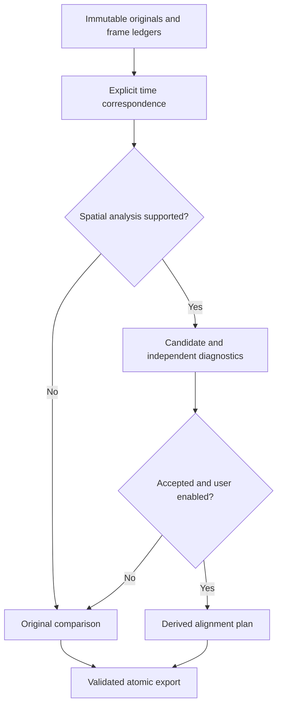

# Guidance, alignment, and export contracts

**Status:** normative design for phases 09–15, not a claim of implemented media processing. Read [capture/coordinate contracts](capture-and-coordinates.md), [the product brief](../PRODUCT_BRIEF.md), and the current status before writing code. API choices must compile for the declared iOS 17 deployment target; newer SDK documentation does not automatically authorize raising it.

## 1. Product invariants

1. Original takes, source-clock metadata, and accepted-frame ledgers are immutable. A derivative can be removed without losing the recording.
2. Spatial guidance is an estimate. Small estimator error does not establish physical repetition accuracy, and successful relocalization does not establish pixel alignment.
3. Temporal correspondence, 3D camera-pose similarity, and 2D image registration answer different questions. Keep their measurements and warnings separate.
4. A planar image warp cannot generally reconcile translating views of a depth-rich scene. The product may refuse alignment and still deliver useful originals.
5. Synthetic fixtures and simulator results remain visibly distinguished from actual device captures throughout storage, review, export, and evidence.
6. The user controls whether a derivative is exported, which audio is included, and where a file is shared. No camera content is sent to a server in the MVP.

## 2. Processing order and safe fallback

The fallback is intentional product behavior, not an error hidden behind a success badge. Review can compare clips whose spatial metadata is incompatible; pose-dependent guidance cannot. Rejected or cancelled registration never prevents sharing a valid original.

## 3. Guidance coordinates and identity

Follow the canonical `destinationFromSource` convention. Persist `referenceFromCamera` in the project reference frame `R`, not raw coordinates in the transient world `W`. The renderer uses the currently resolved `worldFromReference` to place the recorded path in the live scene. Preserve `referenceOriginID`, map/anchor identity, and `trackingEpoch` as separate fields. A session may acquire a new epoch while restoring the same verified reference frame; a reset without restoration does not.

For two valid poses in the same reference frame, positional distance is the Euclidean distance between their camera centers. Directional guidance uses the error vector expressed in the target camera's local axes. Unit-quaternion orientation difference uses the shortest equivalent rotation; `q` and `-q` describe the same orientation. Reject nonfinite/invalid rotations before evaluating distances. Convert meters/radians to display units only at the presentation boundary.

Rendering simplification must not alter the analysis path. Rehearsal progress is bounded and monotonic unless explicitly restarted; timed capture uses elapsed capture time. A nearest-position search over the entire path can jump across a loop and is not an acceptable implementation. Tracking validity and sample freshness gate every precise cue.

## 4. Time correspondence is an explicit model

The capture ledger preserves source AR timestamps and maps each accepted encoded frame to its actual rational media presentation time. Its chosen timescale and rounding policy are recorded. Callback arrival time and calendar time are never capture time. The pure core represents rational values without importing Core Media; an adapter converts to/from `CMTime`.

Define review mapping as `retakeTime = referenceTime + offset`, using each media asset's normalized presentation timeline. Trim intervals use a documented half-open convention, with final sample selection constrained by actual asset duration. Store the mapping direction in schema and tests. A positive offset means sampling a later time in the retake. Never infer that both first frames contain the same action merely because each has elapsed time zero.

V1 uses one user-adjustable constant offset and exposes valid overlap. It does not silently time-stretch either performance. If variable pacing makes the pair unusable, say so. Any later piecewise warp needs its own phase, derivative format, audio policy, and independent validation.

Prefer the capture adapter's validated ARKit audio route when supported. Preserve audio-buffer PTS and establish its relationship to video using available clock information and measured events. If this relationship cannot be validated, support a disclosed muted mode rather than stretching or offsetting audio until one test appears correct. Reference and retake audio are alternative tracks for a composite, not an automatic mix.

## 5. Derived contracts and ownership

These are planned logical types; conform their serialization to the phase-04 store schema before implementation:

| Type | Required meaning |
| --- | --- |
| `TimeAlignmentPlan` | Source take IDs/fingerprints, offset direction/value, overlap, trims, schema/configuration version |
| `RegistrationCandidate` | Time-aligned frame IDs, transform direction, analysis scale/ROI, proposed transform and valid region |
| `RegistrationDiagnostics` | What was actually measured: residuals, coverage/crop, numerical checks, unsupported conditions and uncertainty |
| `RegistrationDecision` | Accepted, refused, insufficient evidence, or cancelled; explicit reason; no fabricated confidence percentage |
| `ExportRequest` | Mode, source/plan IDs, dimensions, rate/color policy, crop, audio choice, destination class |
| `ExportReceipt` | Actual output metadata, request ID, processing version, validation outcome and local result reference |

Source fingerprints invalidate derived plans after an input changes. Changing offset, selected ROI, crop, or algorithm configuration invalidates relevant registration caches. An actor owns mutable job state and media resources; UI state is a lightweight snapshot on the main actor. Every callback carries an operation identifier so cancelled work cannot publish over a newer project.

## 6. Conservative image registration

Start with translation-only correction and evaluate homography only as an optional extension. A Vision homographic request estimates a perspective transform. It is not a guarantee that a whole scene is geometrically explained. Do not invent inlier counts or probabilistic confidence from an API that did not return them.

Analysis may use a downsampled, user-selected static-background region. Track every crop, orientation, and scale transform. Compose them correctly when mapping the candidate back into original-image coordinates. Normalize image pixels separately from camera/world coordinates: a correct matrix in one space may be wrong in another.

Independent checks must cover finite/stable transforms, corner topology, valid support, crop loss, held-out residuals, and disagreements between different scene regions. Proposals that fit one wall while visibly displacing a nearby subject require refusal or a conspicuous limitation, not a global green verdict. Warps with low texture, ambiguous repeated patterns, unstable frame-to-frame motion, or inadequate overlap need an insufficient-evidence state. Preserve raw-versus-aligned comparison and render rejected spans as rejected, not interpolated confidence.

## 7. Export transaction and color policy

The export worker reads immutable inputs and produces a unique scratch output within the app's controlled directory. Validate arguments, paths, format support, and available space before processing. Bound decoding/rendering/writing buffers; backpressure is not permission to retain an entire clip in memory. Do not launch a second capture session merely to obtain media for export.

Start with one verified SDR output path and actual supported dimensions/rates. Preserve orientation correctly and document any resampling. Unsupported HDR must be rejected or passed through an explicitly tested tone-mapping pipeline; metadata changes alone cannot convert its pixel values. Likewise, a requested 60 fps output does not create real intermediate motion from a 30 fps source.

Final success requires writer/exporter completion, reopening the resulting file, and validating readable tracks, duration, dimensions, orientation, audio policy, and expected timing. Only then atomically publish it and return a receipt. Cancellation removes only the current job's owned scratch files. An existing original or prior export is never a cleanup target. User-visible Photos/share success follows that operation's result, not the creation of a local file.

## 8. Evidence and change policy

Pure tests cover math, timeline direction, cache invalidation, and state transitions. Simulator tests exercise generated media and actual UI. Real-device tests establish capture interoperability, tracking, parallax, color/audio behavior, and usefulness. Separate numerical fixture accuracy from practical handheld success rates. CI artifacts are temporary; archive acceptance evidence only in an owner-approved location with consent and retention rules.

Changing accepted formats, registration thresholds, coordinate conventions, timestamp mapping, or public claims requires regression fixtures and an updated phase report. Physical proof remains a hard gate before marketing the core effect. A useful framing-assistant pivot is legitimate; pretending an unsupported effect works is not.

## Primary references

- [Apple: ARCamera](https://developer.apple.com/documentation/arkit/arcamera)
- [Apple: CMTime](https://developer.apple.com/documentation/coremedia/cmtime)
- [Apple: Vision homographic registration](https://developer.apple.com/documentation/vision/vnhomographicimageregistrationrequest)
- [Apple: aligning similar images](https://developer.apple.com/documentation/vision/aligning-similar-images)
- [OpenCV: homography assumptions](https://docs.opencv.org/4.x/d9/dab/tutorial_homography.html)
- [Apple: AVAssetWriter](https://developer.apple.com/documentation/avfoundation/avassetwriter)
- [Apple: AVAssetExportSession](https://developer.apple.com/documentation/avfoundation/avassetexportsession)

Reviewed during setup on 2026-10-26. These references establish API mechanisms and geometry constraints. The product policies and thresholds above are project decisions, not source-backed performance guarantees.
